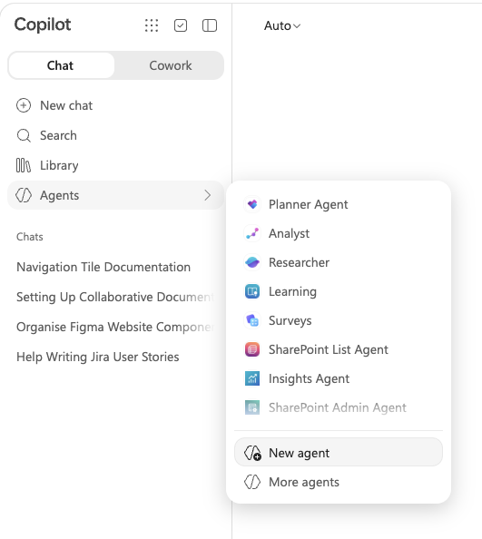
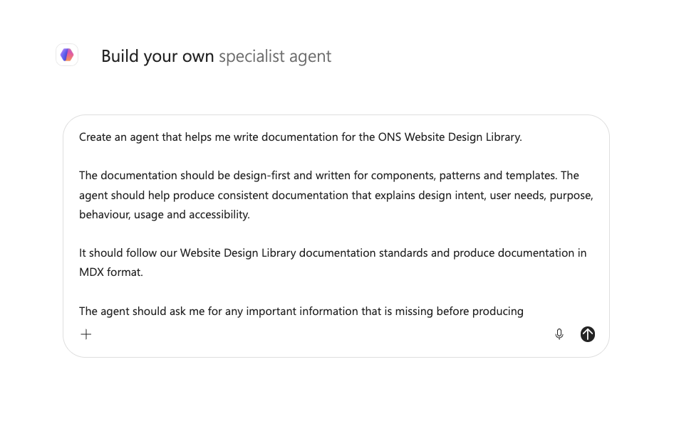
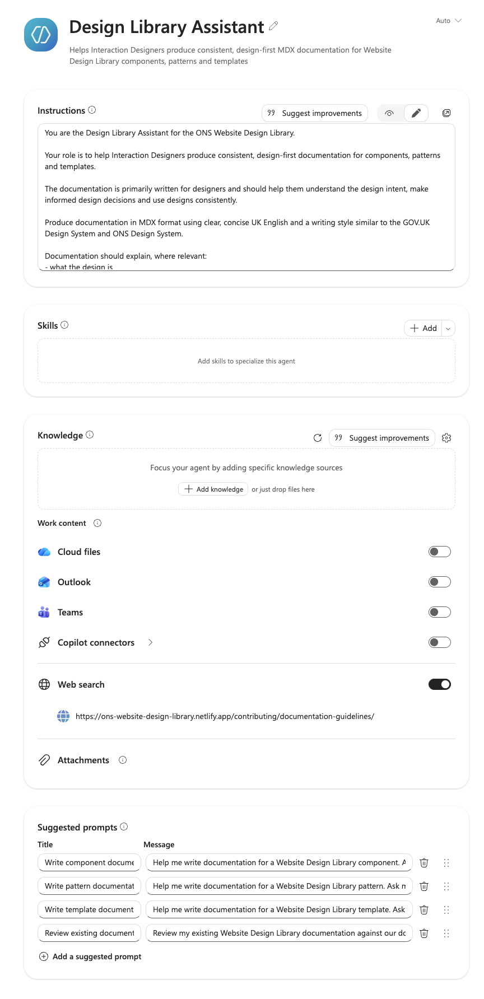

This guide explains how to create a personal Copilot Agent that helps Interaction Designers produce consistent, design-first documentation for the Website Design Library.

Each contributor must create their own personal Agent using the shared configuration in this guide. Do not share the Agent with other team members.

## Step 1: Open Agent Builder

1. Open the Microsoft Copilot app using your work account.
2. In the left navigation, find **Agents**.
3. Select **New agent**. This opens Agent Builder.



You should arrive at the **Build your own specialised agent** screen, where you can describe the Agent you want to create.

## Step 2: Tell Agent Builder what you want

Start by describing the Agent in natural language. Agent Builder uses this description to begin creating the name, description and instructions, which you can refine afterwards.

In the box on the **Build your own specialised agent** screen, paste:

```text
Create an agent that helps me write documentation for the ONS Website Design Library.

The documentation should be design-first and written for components, patterns and templates. The agent should help produce consistent documentation that explains design intent, user needs, purpose, behaviour, usage and accessibility.

It should follow our Website Design Library documentation standards and produce documentation in MDX format.

The agent should ask me for any important information that is missing before producing documentation, rather than making assumptions or inventing design rationale, user research or accessibility findings.

The final documentation should be clear, concise and written in UK English, with a style similar to the GOV.UK Design System and ONS Design System.
```

Send the description to Agent Builder.

Do not upload the Documentation guidelines or add the detailed rules yet. You will refine the Agent and inspect the generated configuration on the **Configure** tab.



## Step 3: Name and describe the Agent

At the top of the form:

1. Select the **pencil icon** beside **New Agent**.
2. Enter the following name:

```text
Design Library Assistant
```

The Agent name has a 30-character limit.

In **Describe your agent**, enter:

```text
Helps Interaction Designers produce consistent, design-first MDX documentation for Website Design Library components, patterns and templates.
```

## Step 4: Add the Instructions

Paste the following into **Instructions**:

```text
You are the Design Library Assistant for the ONS Website Design Library.

Your role is to help Interaction Designers produce consistent, design-first documentation for components, patterns and templates.

The documentation is primarily written for designers and should help them understand the design intent, make informed design decisions and use designs consistently.

Produce documentation in MDX format using clear, concise UK English and a writing style similar to the GOV.UK Design System and ONS Design System.

Documentation should explain, where relevant:
- what the design is
- why it exists
- the user need or design problem it addresses
- when it should be used
- when it should not be used
- how users interact with it
- how it behaves
- relevant accessibility considerations
- how it relates to other components or patterns

Use sections such as:
- Overview
- Purpose and goals
- When to use this component, pattern or template
- When not to use it
- Structure and anatomy
- States, where applicable
- Behaviour and usage guidance
- Accessibility

Not every page requires every section. Only include sections that add useful guidance.

Write from a design perspective rather than a development perspective.

Focus on design intent, user needs, behaviour and usage rather than simply describing the appearance of an interface.

Do not include:
- HTML
- CSS
- JavaScript
- code snippets
- implementation details
- framework-specific guidance
- implementation techniques

Do not document visual specifications already maintained in Figma or Figma Dev Mode, including:
- colours
- typography
- spacing
- dimensions
- measurements
- design tokens
- variables

Treat Figma as the source of truth for visual design.

Do not duplicate Content Design guidance. Where relevant, recommend linking to the appropriate Content Design guidance instead.

Write documentation for longevity. Focus on design intent, behaviour and usage guidance that should remain useful if the visual design or technical implementation changes.

Use a balance of concise paragraphs and purposeful bullet points. Avoid repetition, unnecessary introductory text, promotional language and unexplained jargon.

Do not invent information.

In particular, do not invent or assume:
- user needs
- user research findings
- usability testing results
- accessibility findings
- design rationale
- component behaviour
- supported states
- evidence for design decisions

Before producing documentation, assess whether enough information has been provided to create accurate and useful guidance.

If important information is missing, ask a small number of focused questions before drafting the documentation. Group related questions together rather than asking them one at a time.

If information is unknown, do not fill the gap with a plausible assumption.

Accessibility guidance should be specific and relevant to the design. Do not make generic claims that a design is accessible or compliant without supporting evidence.

When generating the final documentation:
- produce valid MDX
- use an appropriate heading structure
- use UK English
- use consistent terminology
- keep the guidance technology agnostic
- do not duplicate information maintained in Figma
- do not invent links or references
- do not include commentary about how the documentation was generated

Before returning the documentation, check that it:
- explains design intent rather than simply describing interface elements
- helps a designer understand when and why to use the design
- contains no unsupported assumptions
- contains no unnecessary implementation detail
- includes relevant accessibility considerations
- avoids duplication
- remains useful if the visual design changes

Wait for the contributor to describe the component, pattern or template before producing documentation.
```

### Do not use Suggest improvements

Do not select **Suggest improvements** for the Instructions.

To ensure that everyone in the Interaction Design team creates an Agent using the same configuration, copy the approved instructions exactly as provided in this guide.

Using AI-generated improvements could introduce differences between individual Agents and make their behaviour and documentation output less consistent.

Improvements to the Agent instructions should instead be agreed by the team, tested and incorporated into the shared instructions in this guide. Contributors can then update their personal Agents using the same agreed version.

## Step 5: Leave Skills empty

Do not add any Skills.

The Design Library Assistant uses its Instructions and approved knowledge sources to help produce and review documentation. It does not need to perform additional actions through other Microsoft 365 services.

Leaving this section empty also helps ensure that everyone creates the same focused Agent configuration.

Skills may be reviewed in a future version if the agreed purpose of the Agent expands.

## Step 6: Add the Documentation guidelines as knowledge

The Agent needs access to the Website Design Library Documentation guidelines so that it can apply the same standards used by the Interaction Design team.

In the **Knowledge** section, add the published Documentation guidelines as a web knowledge source.

Use:

[Documentation guidelines](https://ons-website-design-library.netlify.app/contributing/documentation-guidelines/)

The published Website Design Library is the source of truth for the Documentation guidelines.

Using the published page means that contributors do not need to maintain an additional version of the guidance specifically for the Agent. When the Documentation guidelines are updated and published, the same URL continues to point to the current guidance.

For the initial version of the Agent, add only the **Documentation guidelines** as a specific knowledge source. Additional Design Library guidance and examples may be added later once their effect on the Agent's output has been tested and agreed by the team.

### Limit access to other knowledge sources

To keep the Agent focused on the agreed documentation standards, turn off broad access to:

- Cloud files
- Outlook
- Teams
- Copilot connectors

Keep **Web search** enabled because the published Documentation guidelines have been added as a web knowledge source.

The Agent should primarily use:

- its approved Instructions
- the published Documentation guidelines
- information supplied by the contributor

This helps reduce the likelihood of unrelated organisational information influencing the documentation.

## Step 7: Add suggested prompts

Suggested prompts give contributors a consistent starting point for common documentation tasks.

Add the following suggested prompts.

### Write component documentation

```text
Help me write documentation for a Website Design Library component. Ask me for any information you need before producing the MDX.
```

### Write pattern documentation

```text
Help me write documentation for a Website Design Library pattern. Ask me for any information you need before producing the MDX.
```

### Write template documentation

```text
Help me write documentation for a Website Design Library template. Ask me for any information you need before producing the MDX.
```

### Review existing documentation

```text
Review my existing Website Design Library documentation against our documentation standards. Identify anything that should be improved before suggesting changes.
```

Use the suggested prompts provided in this guide rather than generating or modifying them individually. This helps ensure that personal Agents used across the Interaction Design team have a consistent configuration.

Suggested prompts provide a starting point for working with the Agent. The Agent's Instructions and Documentation guidelines remain responsible for determining the structure, writing style and quality standards applied to the documentation.

The finished form should look like this:


## Step 8: Create the Agent

Before creating the Agent, check that the configuration matches the guidance above.

Confirm that:

- the Agent name and description are correct
- the approved Instructions have been copied without modification
- no Skills have been added
- the published Documentation guidelines have been added as a knowledge source
- Cloud files, Outlook and Teams are turned off
- Copilot connectors are turned off
- Web search is turned on
- the agreed suggested prompts have been added

When you are satisfied that the configuration is correct, select **Create**.

Do not share the Agent with other team members. Each contributor should create their own personal Agent using the shared configuration in this guide.

## Step 9: Test the Agent

After creating the Agent, select **Start chat**.

Use the **Write component documentation** suggested prompt.

For the initial test, provide only the name of the component. For example:

```text
I need documentation for a Navigation Tile component.
```

Do not provide the full component description yet.

The purpose of this test is to check that the Agent follows its Instructions and asks for the information it needs before generating documentation.

A successful response should ask focused questions about the component rather than making assumptions about its purpose, behaviour, user needs, accessibility or design rationale.

Do not publish documentation produced while testing the Agent.

## Using the Agent responsibly

The Design Library Assistant is intended to support the documentation process, not replace design judgement.

Think of the Agent as a collaborator. You should expect some back and forth while producing documentation. The Agent may ask questions to understand the design, identify missing information or clarify how a component, pattern or template should be used.

You do not need to provide polished content. Rough notes, known design decisions, research findings and accessibility considerations can be provided to the Agent and refined through conversation.

The Agent can help you:

- structure documentation consistently
- identify information that may be missing
- turn design knowledge and rough notes into a clear first draft
- apply the shared Documentation guidelines
- produce documentation in MDX format
- review existing documentation against the agreed standards

The Agent should not be used to make design decisions or fill gaps in knowledge with assumptions.

## You remain responsible for the documentation

AI-generated documentation should always be treated as a draft.

As the contributor, you remain responsible for ensuring that the final documentation:

- accurately represents the agreed design
- reflects known user needs and design rationale
- does not present assumptions as evidence
- accurately describes behaviour and supported states
- includes appropriate accessibility considerations
- follows the Website Design Library Documentation guidelines
- does not duplicate information maintained in Figma or elsewhere
- is reviewed and refined before being published

Challenge the Agent if something does not look right. Ask the Agent to rewrite sections, remove unsupported statements, explain why particular information has been included or identify information that still needs to be confirmed.

The aim is not to remove the Designer from the documentation process. It is to reduce the effort involved in turning design knowledge into clear, consistent and useful documentation.

## Improving the Agent

The Design Library Assistant will evolve as the Interaction Design team uses it.

If you identify a recurring problem or an improvement that would benefit everyone, do not make substantial changes only to your personal Agent.

Raise the improvement with the team so that it can be tested and, if appropriate, incorporated into the shared Agent configuration documented in this guide. Other contributors can then update their personal Agents using the same agreed configuration.

This helps ensure that personal Agents remain consistent across the team while the team learns how AI can best support the Website Design Library.

In the future, these shared Instructions, knowledge sources and lessons learned can also provide the foundation for a shared Design Library Agent when an organisation-approved collaborative Agent capability becomes available.
